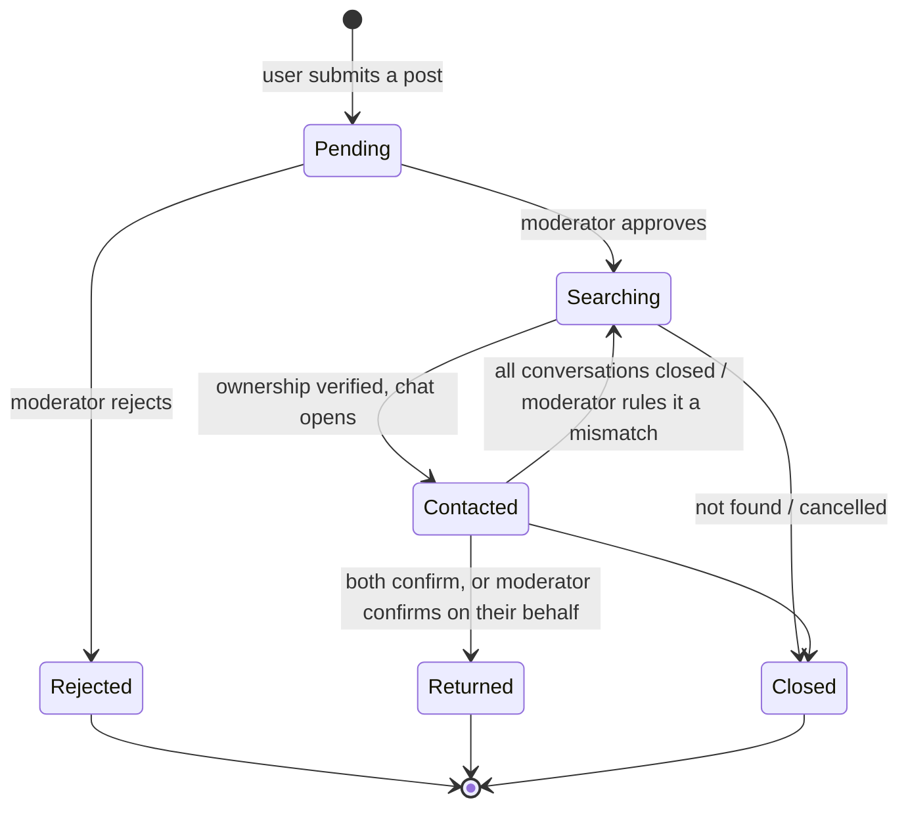

# LostLink

**English** | [Tiếng Việt](README.vi.md)

**A community-driven lost & found platform.**

LostLink connects two groups of people: those who **lost** something and those who **found** something. Instead of forcing users to dig through thousands of posts, the system runs a matching engine every time a new post appears and proactively pushes suggestions ("This might be your item?") to both sides.

Matching is built on three data axes — **location**, **time**, and **item attributes** — plus a layer of community trust (reputation scores, ownership verification, and moderation).

## Key features

- **LOST / FOUND posts** with flexible categories, dynamic attributes, photos.
- **Two-way matching engine** — explainable and statistics-based (no ML). Hard gates on location + time + exclusive attributes narrow candidates; location, time, category, attributes and description are each scored and combined as evidence with the Fellegi-Sunter model to rank the rest. Photos are not scored; they are shown in each suggestion so users can compare for themselves. Details in the [algorithm doc](docs/design/matching-algorithm.md) (Vietnamese).
- **Ownership verification** — a finder's security question (or a contact request) must be passed before contact details are revealed and chat opens.
- **Chat & handover** with safe public meetup suggestions and a mutual "returned" confirmation that marks the post as returned.
- **Reputation & leaderboard** — trust points and badges earned from completed handovers and reviews.
- **Area alerts (geofence)** — get notified when a new post appears in a zone you follow.
- **Moderation & anti-fraud** — reporting, review queues, escalation for stalled deals, and automated email reminders.

## Post lifecycle

A post has 6 states. Every transition is stored in the post's status history (who changed it, when, and why) to build its timeline.



| State         | Meaning                                                                                                                         |
| ------------- | ------------------------------------------------------------------------------------------------------------------------------- |
| **Pending**   | New post waiting for moderator review. Not public and not used for matching yet.                                                |
| **Rejected**  | A moderator rejected the post at review, so it is not published.                                                                |
| **Searching** | Post is public and participates in matching.                                                                                    |
| **Contacted** | Ownership was verified and a chat is open. Goes back to Searching only when every conversation about the post has been closed.  |
| **Returned**  | Both sides confirmed the handover (or a moderator did on their behalf). Reputation is awarded; the post is hidden after 7 days. |
| **Closed**    | The item was never found, or the owner cancelled the post.                                                                      |

## Roles

Permissions are inherited (each higher role includes the lower ones):

| Role          | Scope                                                                                                                  |
| ------------- | ---------------------------------------------------------------------------------------------------------------------- |
| **Guest**     | Browse and filter public posts, view the leaderboard and overall stats.                                                |
| **User**      | Post and manage items, handle match suggestions, verify & chat, claim, comment, review, set area alerts, report.       |
| **Moderator** | Review posts, handle reports, temporarily lock accounts, resolve escalations and confirm handovers on behalf of users. |
| **Admin**     | Manage users and roles, tune matching parameters & thresholds, manage categories/attributes, dashboards, audit logs.   |

## Tech stack

- **Frontend** (`frontend/`) — React 19 + Vite, React Router, Tailwind CSS.
- **Backend** (`backend/`) — Node.js + Express, MongoDB (Mongoose), JWT authentication.

## Project structure

```
LostLink/
├─ frontend/   # React + Vite web client
├─ backend/    # Express + MongoDB API
├─ docs/       # Project documentation
└─ .github/    # CI workflow, PR template
```

## Getting started

Requires Node.js 24 and MongoDB.

```bash
# Backend
cd backend
npm install
copy .env.example .env   # (macOS/Linux: cp)
npm run seed
npm run dev

# Frontend (in a new terminal)
cd frontend
npm install
npm run dev
```

## Staging

Deployed on Render from `main` (config in [`render.yaml`](render.yaml)): https://lostlink-web.onrender.com

- The test accounts below are **local only**. Staging accounts use different passwords and are not published; ask the team if you need one.
- The backend sleeps after 15 minutes idle, so the first request can take up to a minute.

## Test accounts (local only)

Created by `npm run seed` in your local database. They do not work on staging.

### Role accounts (one per permission level)

| Role          | Email               | Password    |
| ------------- | ------------------- | ----------- |
| **Admin**     | `admin@lostlink.vn` | `Admin@123` |
| **Moderator** | `mod@lostlink.vn`   | `Mod@1234`  |
| **User**      | `user@lostlink.vn`  | `User@1234` |

### Community members (authors of the sample posts)

These match the handles shown in the demo feed, leaderboard and profiles. They
all share the password **`User@1234`**.

| Handle (username) | Email                      | Reputation |
| ----------------- | -------------------------- | ---------- |
| `minhkhoi.td`     | `minhkhoi.td@lostlink.vn`  | 312        |
| `hoangnam.q1`     | `hoangnam.q1@lostlink.vn`  | 248        |
| `baotran.sg`      | `baotran.sg@lostlink.vn`   | 174        |
| `ngockhanh.dn`    | `ngockhanh.dn@lostlink.vn` | 141        |
| `thuylinh.hn`     | `thuylinh.hn@lostlink.vn`  | 96         |
| `ducanh.bk`       | `ducanh.bk@lostlink.vn`    | 60         |
