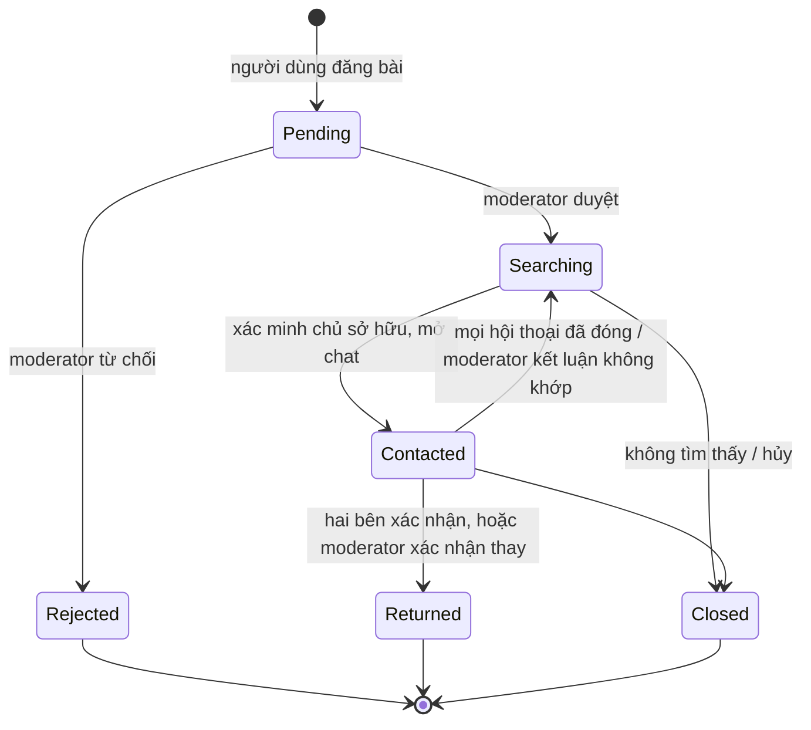

# LostLink

[English](README.md) | **Tiếng Việt**

**Nền tảng tìm đồ thất lạc dựa trên cộng đồng.**

LostLink kết nối hai nhóm người: người **làm mất** đồ và người **nhặt được** đồ. Thay vì để người dùng tự lục tìm trong hàng nghìn bài đăng, mỗi khi có bài mới hệ thống sẽ chạy bộ ghép cặp và chủ động gửi gợi ý ("Đây có phải đồ của bạn?") cho cả hai bên.

Việc ghép cặp dựa trên ba trục dữ liệu là **vị trí**, **thời gian** và **thuộc tính món đồ**, cộng thêm một lớp tin cậy cộng đồng gồm điểm uy tín, xác minh chủ sở hữu và kiểm duyệt.

## Tính năng chính

- **Bài đăng MẤT / NHẶT ĐƯỢC** với danh mục linh hoạt, thuộc tính động và hình ảnh.
- **Bộ ghép cặp hai chiều**: dựa trên thống kê, giải thích được (không dùng ML). Lọc cứng theo vị trí, thời gian và thuộc tính loại trừ để thu hẹp ứng viên; các tiêu chí vị trí, thời gian, danh mục, thuộc tính và mô tả được chấm điểm rồi cộng thành bằng chứng theo mô hình Fellegi-Sunter để xếp hạng. Hình ảnh không dùng để chấm điểm mà hiển thị trong gợi ý để người dùng tự đối chiếu. Chi tiết ở [tài liệu thuật toán](docs/design/matching-algorithm.md).
- **Xác minh chủ sở hữu**: phải trả lời đúng câu hỏi bảo mật của người nhặt (hoặc gửi yêu cầu liên hệ) thì mới thấy thông tin liên lạc và mở được chat.
- **Chat và bàn giao**: gợi ý điểm hẹn công cộng an toàn, và hai bên cùng xác nhận "đã trao trả" để chuyển bài sang trạng thái Đã trao trả.
- **Uy tín và bảng xếp hạng**: điểm tin cậy và huy hiệu nhận được từ các lần bàn giao thành công và đánh giá.
- **Cảnh báo theo khu vực (geofence)**: nhận thông báo khi có bài mới trong khu vực bạn theo dõi.
- **Kiểm duyệt và chống gian lận**: báo cáo vi phạm, hàng đợi duyệt bài, chuyển cấp xử lý cho các giao dịch bị đình trệ, và email nhắc nhở tự động.

## Vòng đời bài đăng

Bài đăng có 6 trạng thái. Mỗi lần chuyển trạng thái được lưu vào lịch sử của bài (ai đổi, lúc nào, lý do) để dựng dòng thời gian.



| Trạng thái                  | Ý nghĩa                                                                                            |
| --------------------------- | -------------------------------------------------------------------------------------------------- |
| **Chờ xét duyệt** (Pending) | Bài mới đăng, đang chờ moderator duyệt. Chưa hiển thị công khai và chưa tham gia ghép cặp.         |
| **Đã từ chối** (Rejected)   | Moderator từ chối bài khi duyệt, nên bài không được đăng.                                          |
| **Đang tìm** (Searching)    | Bài đã công khai và tham gia ghép cặp.                                                             |
| **Đã liên hệ** (Contacted)  | Đã xác minh chủ sở hữu và mở chat. Chỉ quay về Đang tìm khi mọi hội thoại về bài này đều đã đóng.  |
| **Đã trao trả** (Returned)  | Hai bên cùng xác nhận (hoặc moderator xác nhận thay). Điểm uy tín được cộng, bài tự ẩn sau 7 ngày. |
| **Đã đóng** (Closed)        | Không tìm thấy món đồ, hoặc chủ bài hủy bài đăng.                                                  |

## Vai trò

Quyền được kế thừa (vai trò cao hơn có toàn bộ quyền của vai trò thấp hơn):

| Vai trò       | Phạm vi                                                                                                                           |
| ------------- | --------------------------------------------------------------------------------------------------------------------------------- |
| **Guest**     | Xem và lọc bài đăng công khai, xem bảng xếp hạng và thống kê chung.                                                               |
| **User**      | Đăng và quản lý bài, xử lý gợi ý ghép cặp, xác minh và chat, nhận đồ, bình luận, đánh giá, đặt cảnh báo khu vực, báo cáo vi phạm. |
| **Moderator** | Duyệt bài, xử lý báo cáo, khóa tài khoản tạm thời, giải quyết các trường hợp chuyển cấp và xác nhận bàn giao thay người dùng.     |
| **Admin**     | Quản lý người dùng và vai trò, điều chỉnh tham số và ngưỡng ghép cặp, quản lý danh mục/thuộc tính, dashboard, nhật ký hệ thống.   |

## Công nghệ

- **Frontend** (`frontend/`): React 19 + Vite, React Router, Tailwind CSS.
- **Backend** (`backend/`): Node.js + Express, MongoDB (Mongoose), xác thực JWT.

## Cấu trúc dự án

```
LostLink/
├─ frontend/   # Web client React + Vite
├─ backend/    # API Express + MongoDB
├─ docs/       # Tài liệu dự án
└─ .github/    # CI workflow, PR template
```

## Bắt đầu

Cần Node.js 24 và MongoDB.

```bash
# Backend
cd backend
npm install
copy .env.example .env   # (macOS/Linux: cp)
npm run seed
npm run dev

# Frontend (mở terminal mới)
cd frontend
npm install
npm run dev
```

## Staging

Deploy trên Render từ nhánh `main` (cấu hình trong [`render.yaml`](render.yaml)): https://lostlink-web.onrender.com

- Các tài khoản thử nghiệm bên dưới **chỉ dùng ở local**. Tài khoản trên staging dùng mật khẩu khác và không công khai, cần thì liên hệ nhóm.
- Backend sẽ ngủ sau 15 phút không có request, nên lần truy cập đầu có thể mất khoảng một phút.

## Tài khoản thử nghiệm (chỉ dùng ở local)

Được tạo bởi `npm run seed` trong database local. Không đăng nhập được trên staging.

### Tài khoản theo vai trò (mỗi cấp quyền một tài khoản)

| Vai trò       | Email               | Mật khẩu    |
| ------------- | ------------------- | ----------- |
| **Admin**     | `admin@lostlink.vn` | `Admin@123` |
| **Moderator** | `mod@lostlink.vn`   | `Mod@1234`  |
| **User**      | `user@lostlink.vn`  | `User@1234` |

### Thành viên cộng đồng (tác giả các bài đăng mẫu)

Các tài khoản này khớp với tên hiển thị trong feed demo, bảng xếp hạng và trang cá nhân. Tất cả dùng chung mật khẩu **`User@1234`**.

| Tên người dùng (username) | Email                      | Uy tín |
| ------------------------- | -------------------------- | ------ |
| `minhkhoi.td`             | `minhkhoi.td@lostlink.vn`  | 312    |
| `hoangnam.q1`             | `hoangnam.q1@lostlink.vn`  | 248    |
| `baotran.sg`              | `baotran.sg@lostlink.vn`   | 174    |
| `ngockhanh.dn`            | `ngockhanh.dn@lostlink.vn` | 141    |
| `thuylinh.hn`             | `thuylinh.hn@lostlink.vn`  | 96     |
| `ducanh.bk`               | `ducanh.bk@lostlink.vn`    | 60     |
