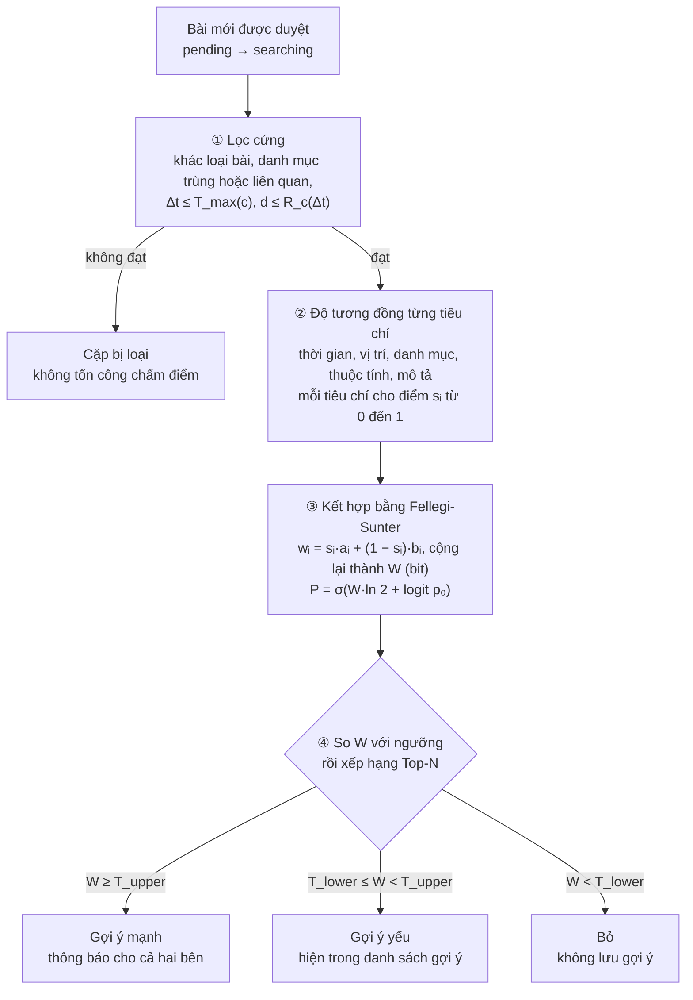

# Thuật toán ghép cặp

Tài liệu thiết kế thuật toán ghép cặp tin Mất đồ với tin Nhặt được của LostLink.

> Mọi tham số trong tài liệu (m, u, λ, k, D, p₀, các ngưỡng) là giá trị minh họa. Chúng cần được ước lượng lại từ dữ liệu khảo sát và dữ liệu vận hành theo [mục 9](#9-ước-lượng-và-tự-cải-thiện-tham-số).

## Mục lục

1. [Mục đích và phạm vi](#1-mục-đích-và-phạm-vi)
2. [Bài toán ghép cặp](#2-bài-toán-ghép-cặp)
3. [Tổng quan thuật toán](#3-tổng-quan-thuật-toán)
4. [Lọc cứng](#4-lọc-cứng)
5. [Độ tương đồng từng tiêu chí](#5-độ-tương-đồng-từng-tiêu-chí)
6. [Kết hợp điểm theo mô hình Fellegi-Sunter](#6-kết-hợp-điểm-theo-mô-hình-fellegi-sunter)
7. [Ví dụ tính tay](#7-ví-dụ-tính-tay)
8. [Bảng tham số](#8-bảng-tham-số)
9. [Ước lượng và tự cải thiện tham số](#9-ước-lượng-và-tự-cải-thiện-tham-số)
10. [Mã giả](#10-mã-giả)
11. [Giới hạn và hướng mở rộng](#11-giới-hạn-và-hướng-mở-rộng)
12. [Thuật ngữ](#12-thuật-ngữ)
13. [Tài liệu tham khảo](#13-tài-liệu-tham-khảo)

## 1. Mục đích và phạm vi

Tài liệu mô tả cách hệ thống quyết định một tin Mất đồ và một tin Nhặt được có cùng nói về một món đồ hay không. Mỗi thành phần được trình bày theo bốn ý: nó làm gì, công thức ra sao, hiểu trực quan thế nào và vì sao chọn nó.

Người đọc chỉ cần biết hàm mũ, logarit và xác suất cơ bản. Thuật ngữ khác được giải thích tại chỗ và tổng hợp ở [mục 12](#12-thuật-ngữ).

Gợi ý cách đọc: muốn nắm ý chính thì đọc mục 2, 3, 6 và 7; muốn hiểu rõ về thuật toán đọc thêm mục 4, 5, 9, 10 và 11.

## 2. Bài toán ghép cặp

LostLink nối người mất đồ với người nhặt được tại TP.HCM. Người dùng không phải tự lục hàng nghìn bài: mỗi khi một bài được kiểm duyệt (trạng thái `pending` chuyển sang `searching`), bộ máy ghép cặp chạy và gửi gợi ý "Đây có phải đồ của bạn?" cho cả hai bên.

### 2.1. Dữ liệu đầu vào

Thuật toán chỉ dùng những trường người dùng nhập khi đăng bài:

| Trường                 | Ý nghĩa                                                                                  | Dùng ở bước                                                                                                                       |
| ---------------------- | ---------------------------------------------------------------------------------------- | --------------------------------------------------------------------------------------------------------------------------------- |
| `type`                 | Mất đồ (`lost`) hay Nhặt được (`found`)                                                  | Lọc cứng                                                                                                                          |
| `category`             | Danh mục: ví, giấy tờ, điện thoại, thú cưng…                                             | Lọc cứng, điểm danh mục                                                                                                           |
| `attributes`           | Thuộc tính theo danh mục: loài, giống, màu, hãng…                                        | Lọc cứng, điểm thuộc tính                                                                                                         |
| `timeFrom`, `timeTo`   | Khoảng thời gian mất hoặc nhặt, vì người dùng thường chỉ nhớ "khoảng 18h đến 20h"        | Lọc cứng, điểm thời gian                                                                                                          |
| `locType`              | `point` (một điểm) hoặc `road_segment` (một đoạn đường)                                  | Tính khoảng cách                                                                                                                  |
| `locExact`             | Tọa độ thật dạng GeoJSON, có index `2dsphere`.                                           | Lọc cứng, điểm vị trí                                                                                                             |
| `title`, `description` | Văn bản tự do                                                                            | Điểm mô tả                                                                                                                        |
| `contents`             | Checklist "Bên trong có" của danh mục vật chứa (ví, túi): tiền mặt, CCCD, thẻ ngân hàng… | Điểm đồ bên trong                                                                                                                 |
| `images`               | Tối đa 9 ảnh, không bắt buộc                                                             | Không chấm điểm; hiển thị trong gợi ý để người dùng đối chiếu ([mục 5.6](#56-ảnh-để-người-dùng-xác-nhận-không-dùng-để-chấm-điểm)) |

Nếu `timeTo` để trống thì coi `timeTo = timeFrom`.

### 2.2. Vì sao khó

Dữ liệu do con người nhập nên mơ hồ, thiếu và đôi khi sai. Cùng một chiếc điện thoại, người mất ghi "xám", người nhặt ghi "bạc". Thời gian là một khoảng, vị trí có sai số khi ghim bản đồ, nhiều trường bị bỏ trống.

Cả hai loại lỗi đều phải trả giá. Bỏ sót một cặp đúng nghĩa là món đồ không về tay chủ. Gợi ý quá nhiều cặp sai thì người dùng mất niềm tin và bỏ qua luôn cả gợi ý đúng. Thuật toán phải cân bằng hai phía đó, và phải giải thích được vì sao gợi ý, vì đề tài không dùng mô hình học máy.

### 2.3. Bài toán liên kết bản ghi

Câu hỏi "bài mất này và bài nhặt kia có cùng chỉ một món đồ không" là một trường hợp của **liên kết bản ghi** (record linkage). Hai bản ghi đến từ hai nguồn, không có mã định danh chung, và cần quyết định chúng có mô tả cùng một thực thể hay không. Ngành thống kê dân số và y tế giải bài toán này từ năm 1969 bằng mô hình Fellegi-Sunter [1], và đó là nền móng của thuật toán ở [mục 6](#6-kết-hợp-điểm-theo-mô-hình-fellegi-sunter).

## 3. Tổng quan thuật toán

Thuật toán chạy mỗi khi một bài được duyệt. Nó ghép bài đó với mọi bài khác loại đang ở trạng thái `searching`, qua bốn bước:



Mấu chốt nằm ở hai câu hỏi được tách riêng:

- **Bước ② hỏi "hai bài giống nhau đến đâu?"** ở từng tiêu chí, cho ra một điểm từ 0 đến 1.
- **Bước ③ hỏi "sự giống đó là bằng chứng mạnh hay yếu?"** Trùng thứ hiếm thì cộng nhiều, trùng thứ phổ biến thì cộng ít, mâu thuẫn thì trừ.

Nếu gộp hai câu hỏi vào một bộ trọng số do người chọn thì không câu nào được trả lời tốt. Tách ra thì câu đầu do các hàm tương đồng lo, câu sau do xác suất đo từ dữ liệu lo.

| Bước              | Đầu vào                                                 | Đầu ra                    | Chi tiết                                             |
| ----------------- | ------------------------------------------------------- | ------------------------- | ---------------------------------------------------- |
| ① Lọc cứng        | `type`, `category`, `attributes`, thời gian, `locExact` | Vài chục ứng viên         | [Mục 4](#4-lọc-cứng)                                 |
| ② Độ tương đồng   | Các trường của hai bài, trừ ảnh                         | Vectơ điểm sᵢ             | [Mục 5](#5-độ-tương-đồng-từng-tiêu-chí)              |
| ③ Kết hợp         | sᵢ cùng tham số m, u                                    | W và P                    | [Mục 6](#6-kết-hợp-điểm-theo-mô-hình-fellegi-sunter) |
| ④ Ngưỡng và Top-N | W                                                       | Bản ghi `MatchSuggestion` | [Mục 6.5](#65-ngưỡng-ra-quyết-định)                  |

## 4. Lọc cứng

**Làm gì.** Trước khi chấm điểm, hệ thống loại ngay những cặp chắc chắn không thể khớp. Một cặp Mất đồ và Nhặt được chỉ đi tiếp khi thỏa tất cả điều kiện sau:

| Điều kiện                           | Công thức                                                                                              | Ý nghĩa                                             |
| ----------------------------------- | ------------------------------------------------------------------------------------------------------ | --------------------------------------------------- |
| Khác loại bài                       | `lost.type ≠ found.type`                                                                               | Không ghép hai bài mất với nhau                     |
| Danh mục trùng hoặc liên quan       | $\mathrm{cat}(found) \in \lbrace \mathrm{cat}(lost) \rbrace \cup \mathrm{Related}(\mathrm{cat}(lost))$ | Ví ghép được với giấy tờ, không ghép với điện thoại |
| Không vô lý về thời gian            | `found.timeTo ≥ lost.timeFrom − ε`                                                                     | Không thể nhặt được món đồ trước khi nó bị mất      |
| Trong cửa sổ thời gian              | $\Delta t \le T_{\max}(c)$                                                                             | Quá lâu so với đặc tính danh mục thì bỏ             |
| Trong bán kính                      | $d \le R_c(\Delta t)$                                                                                  | Quá xa so với thời gian đã trôi qua thì bỏ          |
| Không mâu thuẫn thuộc tính loại trừ | Với mỗi thuộc tính có vai trò Loại trừ mà cả hai bài đều điền: giá trị phải trùng                      | Thú cưng loài chó không ghép với loài mèo           |

**Vì sao cần.** Chấm điểm đầy đủ một cặp khá tốn kém (tách từ, TF-IDF). Lọc cứng thu tập ứng viên từ toàn bộ bài đang `searching` xuống còn vài chục bài. Đây là kỹ thuật chuẩn trong liên kết bản ghi, gọi là **blocking** [3].

**Hiện thực.** MongoDB làm phần vị trí rất nhanh bằng `$geoNear` trên index `2dsphere` của `locExact`. Truy vấn sơ bộ dùng bán kính lớn nhất có thể là $R_c(T_{\max}(c))$, sau đó kiểm tra chính xác $d \le R_c(\Delta t)$ cho từng ứng viên, vì bán kính phụ thuộc vào Δt của từng cặp.

**Ngưỡng lọc nhất quán với điểm.** $T_{\max}$ và $R_c$ không phải hằng số riêng mà được suy ra từ chính tham số chấm điểm ở [mục 5.1](#51-thời-gian-hàm-sống-sót-weibull) và [mục 5.2](#52-vị-trí-nhân-gauss-và-mô-hình-khuếch-tán). Nhờ vậy, cặp bị loại ở bước lọc cũng là cặp sẽ có điểm gần 0 nếu được chấm.

**Dung sai ε.** Điều kiện "không vô lý về thời gian" có dung sai ε (mặc định 1 ngày), vì người dùng hay nhớ sai giờ hoặc chọn nhầm ngày. Không có ε, một lỗi nhập nhỏ sẽ loại vĩnh viễn một cặp đúng.

**Danh mục liên quan theo chiều bài mất.** Quan hệ danh mục do admin khai báo cho từng danh mục nguồn (`CategoryMatchRelation.sourceCategory`). Thuật toán tra quan hệ theo danh mục của **bài mất**: bài mất "Ví" ghép được với bài nhặt "Giấy tờ" khi admin khai báo "Giấy tờ" là danh mục liên quan của "Ví". Khi hai bài khác danh mục, mọi tham số theo danh mục (λ, k, D, `matchRadius`) cũng lấy của danh mục bài mất, vì đó là món đồ thật sự bị mất.

## 5. Độ tương đồng từng tiêu chí

Mỗi tiêu chí cho một điểm $s_i \in [0, 1]$, hoặc báo "thiếu dữ liệu" để bị bỏ qua ở bước kết hợp.

### 5.1. Thời gian: hàm sống sót Weibull

**Bước 1, tính khoảng chờ Δt.** Mỗi bài có một khoảng `[timeFrom, timeTo]`. Khoảng chờ là đoạn trống giữa lúc mất muộn nhất có thể và lúc nhặt sớm nhất có thể:

$$
\Delta t = \max\bigl(0,\ found.timeFrom - lost.timeTo\bigr) \quad \text{(ngày)}
$$

Nếu hai khoảng chồng nhau thì Δt = 0, tức thời gian hoàn toàn khớp. Bài nhặt nằm hẳn trước bài mất đã bị loại ở bước lọc, nên Δt không bao giờ âm.

**Bước 2, đổi Δt thành điểm.**

$$
S_{time}(\Delta t) = \exp\left[-\left(\frac{\Delta t}{\lambda_c}\right)^{k_c}\right]
$$

Trong đó $\lambda_c$ (tham số tỉ lệ) là thời gian đặc trưng của danh mục c, còn $k_c$ (tham số hình dạng) quyết định đường cong giảm nhanh hay chậm.

**Hiểu trực quan.** Trong thống kê, hàm sống sót S(t) là xác suất "sự kiện chưa xảy ra tính đến thời điểm t". Ở đây sự kiện là "món đồ được nhặt và đăng bài". Vậy $S_{time}$ trả lời câu hỏi: chờ Δt ngày mới có bài nhặt thì có bình thường với loại đồ này không. Chỉ cần đổi k là có ba dạng hành vi:

| Giá trị k | Hình dạng                                    | Phù hợp với                                                                                                                                                |
| --------- | -------------------------------------------- | ---------------------------------------------------------------------------------------------------------------------------------------------------------- |
| k > 1     | Giữ điểm cao một thời gian rồi rơi nhanh     | Ví, điện thoại, giấy tờ: nếu có người nhặt thì thường trong vài giờ đến một ngày                                                                           |
| k = 1     | Giảm đều theo hàm mũ                         | Trang sức, phụ kiện: đồ nhỏ rơi xuống khó thấy ngay, thường chỉ được phát hiện ngẫu nhiên lúc ai đó dọn dẹp hay đi ngang, có thể hôm sau hoặc vài ngày sau |
| k < 1     | Giảm nhanh lúc đầu rồi chậm dần, có đuôi dài | Thú cưng: có thể nhiều tuần sau mới có người gặp                                                                                                           |


Đường của ví gần như về 0 sau 4 ngày. Đường trang sức giảm đều, sau 7 ngày còn 0.25 và về gần 0 sau khoảng 2 tuần. Đường thú cưng giảm chậm và sau 30 ngày vẫn còn 0.26. Đó là cái đuôi dài mà k < 1 tạo ra.

**Tham số dễ hiểu cho admin.** Admin không cần biết λ là gì. Admin nhập **trung vị thời gian chờ**, tức "một nửa số trường hợp được nhặt trong vòng bao nhiêu ngày", và hệ thống tự đổi sang λ:

$$
\Delta t_{median} = \lambda \cdot (\ln 2)^{1/k} \quad\Longleftrightarrow\quad \lambda = \frac{\Delta t_{median}}{(\ln 2)^{1/k}}
$$

**Cửa sổ lọc** $T_{\max}$ là thời điểm điểm thời gian rơi xuống dưới ngưỡng $S_{\min}$ (mặc định 0.05):

$$
T_{\max}(c) = \lambda_c \cdot \bigl(-\ln S_{\min}\bigr)^{1/k_c}
$$

| Danh mục            | λ       | k   | Trung vị    | $T_{\max}$ (với $S_{\min}$ = 0.05) |
| ------------------- | ------- | --- | ----------- | ---------------------------------- |
| Ví, giấy tờ         | 2 ngày  | 1.5 | ≈ 1.6 ngày  | ≈ 4 ngày                           |
| Trang sức, phụ kiện | 5 ngày  | 1   | ≈ 3.5 ngày  | ≈ 15 ngày                          |
| Thú cưng            | 20 ngày | 0.7 | ≈ 11.8 ngày | ≈ 96 ngày                          |

**Vì sao chọn Weibull.**

| Phương án                                          | Ưu điểm                                       | Nhược điểm                                                        |
| -------------------------------------------------- | --------------------------------------------- | ----------------------------------------------------------------- |
| Cửa sổ bậc thang (trong N ngày được 1, ngoài là 0) | Đơn giản nhất                                 | Ngày N được 1 nhưng ngày N + 1 thành 0, không có vùng chuyển tiếp |
| Giảm tuyến tính                                    | Dễ hiểu                                       | Không mô tả được đuôi dài của thú cưng                            |
| Hàm mũ $e^{-\Delta t/\tau}$                        | Có cơ sở thống kê                             | Một tham số, mọi danh mục chỉ có một hình dạng                    |
| **Weibull**                                        | Hai tham số, chứa hàm mũ như trường hợp k = 1 | Thêm một tham số cần ước lượng                                    |

Weibull là phân phối kinh điển trong phân tích thời gian chờ (survival analysis), được dùng từ năm 1951 [4] cho bài toán từ độ bền vật liệu đến thời gian hồi phục bệnh nhân.

### 5.2. Vị trí: nhân Gauss và mô hình khuếch tán

**Bước 1, tính khoảng cách d.** Trái Đất cong nên không dùng Pythagoras trên kinh độ, vĩ độ. Công thức Haversine tính khoảng cách trên mặt cầu, với φ là vĩ độ, λ là kinh độ (radian) và R = 6 371 000 m:

$$
a = \sin^2\frac{\Delta\varphi}{2} + \cos\varphi_1 \cos\varphi_2 \sin^2\frac{\Delta\lambda}{2}, \qquad d = 2R \cdot \mathrm{atan2}\bigl(\sqrt{a}, \sqrt{1-a}\bigr)
$$

- **Điểm với đoạn đường:** chiếu vuông góc điểm lên đoạn. Nếu hình chiếu rơi ra ngoài đoạn thì lấy đầu mút gần nhất. Cách này hợp với các bài kiểu "rơi đâu đó trên đường Nguyễn Thị Minh Khai".
- **Hai đoạn đường:** lấy khoảng cách nhỏ nhất giữa hai đoạn, bằng 0 nếu chúng cắt nhau.

**Bước 2, bán kính bất định theo thời gian.** Chỗ bài nhặt được ghim thường lệch so với chỗ bài mất được ghim. Độ lệch đó đến từ hai nguồn, cộng dồn với nhau:

$$
\sigma_c(\Delta t)^2 = \underbrace{\sigma_{0,c}^2}_{\text{ngay lúc mất}} + \underbrace{2 D_c \Delta t}_{\text{lang thang theo thời gian}}, \qquad \sigma_{0,c} = \frac{matchRadius_c}{3}
$$

| Ký hiệu        | Tên                   | Ý nghĩa                                                                                          |
| -------------- | --------------------- | ------------------------------------------------------------------------------------------------ |
| σ              | Độ lệch chuẩn         | "Bán kính bất định" của vị trí, đơn vị mét                                                       |
| $\sigma_{0,c}$ | Vùng bất định ban đầu | Độ lệch có ngay lúc mất: sai số ghim cộng quãng di chuyển ban đầu. Suy từ `Category.matchRadius` |
| $D_c$          | Hệ số khuếch tán      | Mức độ đi lang thang chậm sau đó, đơn vị m²/ngày. Đồ vật nằm yên có D = 0                        |

**Nguồn 1, vùng bất định ban đầu σ₀.** Ngay tại Δt = 0 đã có độ lệch, vì ba lý do:

- **Sai số ghim.** Người dùng chỉ nhớ đại khái chỗ mất hoặc chỗ nhặt, nên ghim lệch vài trăm mét. Lý do này đúng với mọi danh mục.
- **Quãng di chuyển lúc mới lạc.** Lý do này chỉ có ở danh mục tự di chuyển. Thú cưng vừa lạc thường hoảng sợ và chạy nhanh, có thể đi 1 đến 2 km (giả định của nhóm, cần kiểm chứng bằng dữ liệu; tham khảo hành vi tìm chó lạc ở [7]) trong vài phút đến vài giờ đầu rồi mới chậm lại.
- **Δt = 0 không có nghĩa là cùng một thời điểm.** Δt bằng 0 khi hai khoảng thời gian chồng nhau ([mục 5.1](#51-thời-gian-hàm-sống-sót-weibull)). Mất "18h đến 20h" và nhặt "19h đến 21h" cho Δt = 0, nhưng thời điểm thật có thể cách nhau tới 3 giờ. Trong 3 giờ đó, con vật vẫn đang chạy.

Vì vậy `matchRadius` mang nghĩa "khoảng cách xa nhất mà món đồ có thể được tìm thấy ngay lúc mất", và σ₀ được chọn bằng `matchRadius / 3` để tại Δt = 0, bán kính lọc 3σ đúng bằng `matchRadius`:

| Loại danh mục                     | σ₀ gồm những gì                       | `matchRadius` minh họa | σ₀      |
| --------------------------------- | ------------------------------------- | ---------------------- | ------- |
| Đồ vật (ví, giấy tờ, điện thoại…) | Chỉ sai số ghim                       | 400 m                  | ≈ 133 m |
| Thú cưng                          | Sai số ghim và quãng chạy lúc mới lạc | 2 400 m                | 800 m   |

**Nguồn 2, lang thang theo thời gian D.** Sau giai đoạn chạy ban đầu, con vật đi lang thang chậm để kiếm ăn và tìm chỗ trú. Giai đoạn này được mô hình hóa như **bước ngẫu nhiên** (random walk), dạng rời rạc của chuyển động Brown [6]. Tính chất nổi tiếng của mô hình này là độ lệch không tăng tuyến tính mà tăng theo căn bậc hai của thời gian, thể hiện qua số hạng $2D\Delta t$ trong $\sigma^2$. Đồ vật nằm yên có D = 0, nên vùng tìm giữ nguyên bằng `matchRadius` suốt thời gian.

**Vì sao cần cả hai tham số.** Hai giai đoạn có tốc độ rất khác nhau, nên một tham số không mô tả được cả hai:

- **Chỉ dùng D, để σ₀ là sai số ghim (300 m):** sau 3 giờ, σ chỉ tăng từ 300 m lên khoảng 357 m, bán kính lọc khoảng 1.1 km. Con chó chạy 1.5 km trong buổi tối bị loại ngay ở bước lọc, dù đó là chuyện bình thường.
- **Tăng D đủ lớn để bao cả giai đoạn chạy:** vùng tìm phình quá nhanh, sau vài tuần bao cả thành phố.
- **Tách riêng:** σ₀ lo bước nhảy ban đầu, D lo phần lang thang chậm. Cả hai giai đoạn đều được mô tả đúng.

**Bước 3, đổi d thành điểm.**

$$
S_{loc} = \exp\left(-\frac{d^2}{2\,\sigma_c(\Delta t)^2}\right), \qquad R_c(\Delta t) = 3\,\sigma_c(\Delta t)
$$

Đây là **nhân Gauss**: d = 0 cho điểm 1, d = σ cho 0.61, d = 2σ cho 0.14, d = 3σ cho 0.01. Bán kính lọc 3σ theo quy tắc 3-sigma: khoảng 99% trường hợp nằm trong 3σ. Ngoài bán kính đó điểm vị trí dưới 0.01, nên cặp bị loại ngay ở bước lọc để khỏi tốn công chấm.

$S_{loc}$ chỉ là điểm của **một tiêu chí**. Điểm vị trí thấp không có nghĩa hai bài không phải cùng một món; kết luận đó thuộc về bước kết hợp ở [mục 6](#6-kết-hợp-điểm-theo-mô-hình-fellegi-sunter), nơi mọi tiêu chí được cộng lại.

**Ví dụ với thú cưng**, `matchRadius` = 2 400 m (σ₀ = 800 m) và D = 150 000 m²/ngày.

Ngay lúc mất (Δt = 0), điểm chỉ phụ thuộc khoảng cách:

| Khoảng cách d | $S_{loc}$          | Diễn giải                                               |
| ------------- | ------------------ | ------------------------------------------------------- |
| 0 m           | 1.00               | Nhặt được ngay tại chỗ mất                              |
| 500 m         | 0.82               | Rất bình thường: con vật chỉ cần chạy vài phút          |
| 1 km          | 0.46               | Có thể: con vật hoảng sợ chạy được quãng này trong buổi |
| 2 km          | 0.04               | Khó: phải chạy liên tục theo một hướng                  |
| Trên 2.4 km   | Bị loại ở bước lọc | Gần như không chạy kịp xa như vậy trong vài giờ đầu     |

Khi thời gian trôi qua, vùng tìm nở rộng. Cùng khoảng cách 1 km cho điểm ngày càng cao:

| Δt      | σ       | Bán kính lọc 3σ | $S_{loc}$ khi d = 1 km |
| ------- | ------- | --------------- | ---------------------- |
| 0 ngày  | 800 m   | 2.4 km          | 0.46                   |
| 7 ngày  | 1.66 km | 5.0 km          | 0.83                   |
| 30 ngày | 3.1 km  | 9.3 km          | 0.95                   |


Cùng khoảng cách 1 km: lúc vừa mất được điểm trung bình (0.46), vì con vật có thể đã chạy tới đó. Sau 30 ngày được 0.95, vì nó có thể đã lang thang khắp vùng và 1 km trở thành khoảng cách rất gần. Vị trí và thời gian được đánh giá cùng nhau như vậy.

**Vì sao chọn mô hình này.**

| Phương án                                | Nhận xét                                                            |
| ---------------------------------------- | ------------------------------------------------------------------- |
| Bán kính cố định, điểm giảm tuyến tính   | Không phụ thuộc thời gian, loại nhầm thú cưng ở những ngày sau      |
| Bán kính tăng tuyến tính theo Δt         | Phình quá nhanh, sau vài tuần bao cả thành phố                      |
| **Nhân Gauss với σ khuếch tán theo √Δt** | Có cơ sở vật lý, chỉ một tham số D dễ giải thích, đồ vật dùng D = 0 |

Nhân Gauss còn giảm mềm: bài cách 950 m không bị đối xử khác hẳn bài cách 890 m như ở bộ lọc bậc thang.

### 5.3. Danh mục

$$
S_{cat} =
\begin{cases}
1 & \text{cùng danh mục} \\
r & \text{danh mục liên quan, ví dụ } r = 0.6 \\
0 & \text{còn lại (đã bị loại ở bước lọc)}
\end{cases}
$$

Danh mục liên quan do admin khai báo qua `CategoryMatchRelation`, ví dụ "Ví" với "Giấy tờ". CCCD thường nằm trong ví: người mất ghi "mất ví", còn người nhặt chỉ thấy và ghi "nhặt được CCCD". Giá trị r < 1 cho biết trùng danh mục liên quan là bằng chứng yếu hơn trùng hẳn.

**Vì sao danh mục có mặt ở cả bước lọc lẫn bước chấm điểm.** Bước lọc chỉ loại những cặp không thể khớp. Bước chấm điểm đánh giá mức độ khớp, và ở [mục 6](#6-kết-hợp-điểm-theo-mô-hình-fellegi-sunter), trùng danh mục còn được cân theo độ hiếm: trùng "Thú cưng" cộng nhiều điểm hơn trùng "Giấy tờ".

### 5.4. Thuộc tính

Mỗi thuộc tính trong `post.attributes` (loài, giống, màu, hãng…) được so riêng và cho một trong ba kết quả:

| Kết quả            | s      | Tác động ở bước kết hợp |
| ------------------ | ------ | ----------------------- |
| Trùng giá trị      | 1      | Cộng điểm               |
| Khác giá trị       | 0      | Trừ điểm                |
| Một bên không điền | Bỏ qua | Không cộng, không trừ   |

So sánh dựa trên `AttributeValue` đã chuẩn hóa qua `Alias`, nên "xám" và "ghi" chỉ được tính là trùng khi admin khai báo chúng là alias của cùng một giá trị.

Mỗi thuộc tính có một **vai trò ghép cặp** do admin chọn:

- **Tính điểm** (mặc định): khác giá trị thì bị trừ điểm b ở bước kết hợp, nhưng cặp vẫn được chấm tiếp.
- **Loại trừ**: khác giá trị thì cặp bị loại ngay ở bước lọc. Trùng giá trị thì vẫn được cộng điểm như thuộc tính Tính điểm. Vai trò này dành cho những thuộc tính mà người dùng gần như không thể ghi sai, ví dụ Loài của danh mục Thú cưng.

**Vì sao tách "thiếu" khỏi "khác".** Người dùng thường bỏ trống trường mình không chắc. Coi ô trống là "khác" thì bài ghi ít thông tin bị phạt oan. Coi là "trùng" thì bài ghi ít lại được lợi. Bỏ qua là lựa chọn trung lập duy nhất, và Fellegi-Sunter cho phép làm vậy một cách tự nhiên vì tổng điểm là tổng các bằng chứng riêng lẻ.

**Đồ bên trong (chỉ danh mục vật chứa).** Với ví và túi, người đăng tích checklist "Bên trong có" (`contents`). Người mất thường nhớ đầy đủ hơn người nhặt, còn người nhặt có thể chỉ mở ra xem sơ. Vì vậy điểm đo theo phần giao nhau so với danh sách ngắn hơn, không phạt việc một bên liệt kê ít hơn:

$$
S_{contents} = \frac{|A \cap B|}{\min(|A|, |B|)}
$$

Một trong hai bài không tích mục nào thì bỏ qua tiêu chí này. Đây là tiêu chí có điểm liên tục như thời gian và vị trí ([mục 6.3](#63-tiêu-chí-có-điểm-liên-tục)).

**Định danh riêng không dùng để chấm điểm.** Những thông tin như số CCCD, biển số xe, IMEI hay tên trên giấy tờ có thể chứng minh ngay hai bài là một món, nhưng chúng là thông tin nhạy cảm. Hệ thống không cho đăng công khai và không dùng để chấm điểm; chúng chỉ xuất hiện trong câu hỏi xác minh quyền sở hữu.

### 5.5. Mô tả: TF-IDF và độ tương đồng cosin

**Làm gì.** Ghép tiêu đề và mô tả của mỗi bài thành một văn bản, biến văn bản đó thành một vectơ (mỗi chiều ứng với một từ), rồi đo góc giữa hai vectơ. Trọng số mỗi từ là TF nhân IDF [5]:

$$
TF(t, doc) = \frac{\text{số lần từ } t \text{ xuất hiện}}{\text{tổng số từ của bài}}, \qquad IDF(t) = \ln\frac{N}{1 + n_t}, \qquad w_{t,doc} = TF \cdot IDF
$$

Với N là tổng số bài và $n_t$ là số bài chứa từ t. Độ tương đồng là cosin của góc giữa hai vectơ A và B:

$$
S_{text} = \cos\theta = \frac{A \cdot B}{\lVert A\rVert\,\lVert B\rVert} = \frac{\sum_t A_t B_t}{\sqrt{\sum_t A_t^2}\,\sqrt{\sum_t B_t^2}}
$$

**Hiểu trực quan.** IDF làm những từ xuất hiện ở gần như mọi bài ("mất", "rơi", "nhặt", "khu vực") có trọng số gần 0, còn từ hiếm ("móc khóa hình mèo", "vòng cổ đỏ") có trọng số cao. Hai bài cùng nhắc "móc khóa hình mèo" sẽ có cosin cao dù câu chữ khác nhau. Cosin không phụ thuộc độ dài bài, nên bài viết dài không tự động được lợi.

**Lưu ý tiếng Việt.** Tiếng Việt viết cách theo âm tiết, nên phải **tách từ** trước: "điện thoại" là một từ, không phải hai. Nên dùng thư viện tách từ có sẵn, ví dụ VnCoreNLP [9], chuẩn hóa dấu và chữ hoa thường trước khi tính.

**Vì sao chọn.** So với đếm từ chung (Jaccard), TF-IDF biết từ nào quan trọng. So với embedding câu bằng mô hình ngôn ngữ, TF-IDF không cần mô hình học máy, chạy nhanh trên Node.js và giải thích được bằng danh sách từ trùng có trọng số cao. BM25 [8] là biến thể mạnh hơn, nhưng với văn bản ngắn như mô tả đồ thất lạc thì khác biệt không đáng kể.

### 5.6. Ảnh: để người dùng xác nhận, không dùng để chấm điểm

Thuật toán không chấm điểm ảnh. Ảnh được hiển thị trong gợi ý để người dùng tự đối chiếu trước khi xác nhận.

**Vì sao không chấm điểm ảnh.** Khi không dùng mô hình học máy, cách so ảnh khả thi là băm cảm nhận (pHash). pHash chỉ nhận ra hai ảnh gần như giống hệt nhau, ví dụ cùng một ảnh bị đăng lại hoặc bị cắt nhẹ. Với bài toán này, hai bên gần như không bao giờ có ảnh giống hệt: người mất thường đăng ảnh chụp từ trước, còn người nhặt chụp ảnh mới tại chỗ, khác góc và khác ánh sáng. Tiêu chí ảnh vì vậy cho điểm thấp ở cả cặp đúng lẫn cặp sai, nên không giúp phân biệt hai loại.

**Ảnh được dùng ở đâu.** Sau khi thuật toán lọc ra vài gợi ý, card gợi ý hiển thị ảnh của bài đối ứng. Người mất nhìn ảnh là nhận ra đồ của mình kể cả khi khác góc chụp, điều mà phép so ảnh bằng máy ở trên không làm được. Sau đó người dùng bấm "Đúng là đồ của tôi" để chuyển sang bước xác minh.

**Ảnh không thay cho bước xác minh.** Ảnh của bài nhặt được hiển thị công khai, nên ai xem gợi ý cũng có thể nhận bừa. Câu hỏi xác minh quyền sở hữu vẫn là chốt chặn trước khi trao trả.

Không chấm điểm ảnh cũng không làm hỏng mô hình. Fellegi-Sunter là tổng các bằng chứng riêng lẻ, nên thiếu một tiêu chí chỉ là thiếu một số hạng; các tiêu chí còn lại giữ nguyên ý nghĩa.

## 6. Kết hợp điểm theo mô hình Fellegi-Sunter

[Mục 5](#5-độ-tương-đồng-từng-tiêu-chí) trả lời "hai bài giống nhau đến đâu ở từng tiêu chí". Mục này trả lời câu hỏi khác: "sự giống nhau đó là bằng chứng mạnh hay yếu", rồi gộp mọi bằng chứng thành một con số có ý nghĩa xác suất.

**Ý tưởng qua một ví dụ đời thường.** Hai người lạ trùng ngày sinh thì đáng chú ý vừa phải, vì xác suất tình cờ là 1/365. Hai người lạ cùng mặc áo trắng thì chẳng nói lên gì, vì rất nhiều người mặc áo trắng. Sức mạnh của một sự trùng khớp không nằm ở chỗ "có trùng" mà ở chỗ "trùng như vậy hiếm đến đâu khi hai bên không liên quan". Fellegi và Sunter (1969) [1] biến trực giác này thành công thức.

### 6.1. Hai xác suất m và u

| Ký hiệu | Định nghĩa                                         | Ví dụ                                                    |
| ------- | -------------------------------------------------- | -------------------------------------------------------- |
| $m_i$   | P(tiêu chí i khớp \| hai bài đúng là cùng một món) | Màu: 0.9, vì người dùng đôi khi ghi "xám" thay cho "bạc" |
| $u_i$   | P(tiêu chí i khớp \| hai bài không liên quan)      | Danh mục Giấy tờ: 0.37. Danh mục Thú cưng: 0.03          |

m thường từ 0.8 đến 0.95, không bằng 1 vì người dùng có thể ghi sai. u tính được trực tiếp từ dữ liệu: u của một giá trị v xấp xỉ tỉ lệ bài có giá trị v.

- **u của danh mục** là tỉ lệ bài thuộc danh mục đó trên toàn bộ bài.
- **u của giá trị thuộc tính** là tỉ lệ bài có giá trị đó **trong cùng danh mục**. Ví dụ u của "Poodle" là tỉ lệ Poodle trong các bài Thú cưng, không phải trong mọi bài. Tính có điều kiện như vậy tránh việc đếm hai lần cùng một bằng chứng (Poodle vốn đã kéo theo Thú cưng).

Bộ dữ liệu khảo sát 2 353 bài từ các nhóm Facebook [11] được dùng để ước lượng u ban đầu. Khi hệ thống chạy, u được tính lại định kỳ từ bài đăng thật.

### 6.2. Trọng số đồng ý và không đồng ý

$$
a_i = \log_2\frac{m_i}{u_i} > 0 \ \text{(cộng điểm)}, \qquad b_i = \log_2\frac{1-m_i}{1-u_i} < 0 \ \text{(trừ điểm)}
$$

m/u là **tỉ số hợp lý** (likelihood ratio): trùng khớp này dễ xảy ra ở cặp đúng gấp bao nhiêu lần so với cặp ngẫu nhiên. Lấy log cơ số 2 thì đơn vị là **bit bằng chứng**: mỗi +1 bit làm tỉ lệ cược "là cùng một món" tăng gấp đôi, mỗi −1 bit làm nó giảm một nửa.

| Trùng gì                       | m    | u    | a = log₂(m/u) | Diễn giải                      |
| ------------------------------ | ---- | ---- | ------------- | ------------------------------ |
| Danh mục Giấy tờ               | 0.95 | 0.37 | +1.36 bit     | Tỉ lệ cược tăng khoảng 2.6 lần |
| Danh mục Thú cưng              | 0.95 | 0.03 | +4.98 bit     | Tăng khoảng 32 lần             |
| Loài hamster (2% bài Thú cưng) | 0.95 | 0.02 | +5.57 bit     | Tăng khoảng 48 lần             |

Hai trọng số giải quyết hai việc:

- **a phân biệt độ hiếm.** Trùng thứ hiếm là bằng chứng mạnh, trùng thứ phổ biến là bằng chứng yếu.
- **b < 0 chặn bù trừ.** Khác màu không chỉ là "không được cộng" mà là bằng chứng chống lại, vì cặp đúng hiếm khi khác màu (1 − m nhỏ). Điểm cao ở tiêu chí này vì vậy không bù được một mâu thuẫn rõ ràng ở tiêu chí khác.

**Vì sao lấy log rồi cộng.** Theo định lý Bayes, nếu các bằng chứng độc lập thì tỉ số hợp lý của chúng nhân với nhau. Log biến phép nhân thành phép cộng, nên tổng điểm vẫn là một phép cộng quen thuộc, chỉ khác ở chỗ mỗi số hạng có ý nghĩa thống kê rõ ràng thay vì do người chọn.

### 6.3. Tiêu chí có điểm liên tục

Thời gian, vị trí, mô tả và đồ bên trong cho ra $s_i$ trong khoảng [0, 1], không chỉ trùng hay khác. Mô hình nội suy tuyến tính giữa hai trọng số:

$$
w_i(s_i) = s_i \cdot a_i + (1 - s_i) \cdot b_i
$$

s = 1 cho đủ a (cộng tối đa), s = 0 cho đủ b (trừ tối đa). Giữa hai đầu có một **điểm hòa vốn** s\*, tại đó tiêu chí không cộng cũng không trừ:

$$
s^* = \frac{-b_i}{a_i - b_i}
$$

Ví dụ tiêu chí thời gian với m = 0.9, u = 0.3 có s\* ≈ 0.64: điểm thời gian trên 0.64 là bằng chứng ủng hộ, dưới 0.64 là bằng chứng chống.

#### Quan hệ giữa Weibull và Fellegi-Sunter

Hai mô hình không thay thế nhau mà nằm ở hai bước khác nhau. Weibull là **thước đo** của riêng tiêu chí thời gian, còn Fellegi-Sunter là **cách cộng** kết quả của mọi thước đo:

|                 | Weibull ([mục 5.1](#51-thời-gian-hàm-sống-sót-weibull))               | Fellegi-Sunter (mục 6)                                                            |
| --------------- | --------------------------------------------------------------------- | --------------------------------------------------------------------------------- |
| Trả lời câu hỏi | Chờ Δt ngày mới có bài nhặt thì có bình thường với loại đồ này không? | Sự giống nhau ở mỗi tiêu chí là bằng chứng mạnh hay yếu, và gộp lại ra bao nhiêu? |
| Phạm vi         | Chỉ tiêu chí thời gian                                                | Mọi tiêu chí                                                                      |
| Đầu vào         | Δt, λ, k của danh mục                                                 | Các điểm sᵢ cùng m, u của từng tiêu chí                                           |
| Đầu ra          | $s_{time} \in [0, 1]$, và cửa sổ lọc $T_{\max}$                       | W (bit) và xác suất P                                                             |

Gauss của vị trí và TF-IDF của mô tả đứng cùng vị trí với Weibull: mỗi cái là thước đo của một tiêu chí, kết quả đều được đưa vào Fellegi-Sunter.

**Chỗ hai mô hình chạm nhau.** Theo định nghĩa, tại đúng trung vị thời gian chờ thì $s_{time}$ = 0.5. Nếu điểm hòa vốn s\* của tiêu chí thời gian lớn hơn 0.5 (như 0.64 ở trên) thì một nửa số cặp đúng bị trừ điểm thời gian. Vì vậy hai bên không độc lập về tham số: đổi λ, k của Weibull thì phân bố $s_{time}$ thay đổi, và m, u của tiêu chí thời gian phải chỉnh lại theo, sao cho s\* không vượt quá 0.5 ([mục 11.1](#111-giới-hạn-và-rủi-ro)).

**Cách ghép hiện tại là xấp xỉ.** Theo đúng Fellegi-Sunter, trọng số thời gian phải là tỉ số hợp lý:

$$
w_{time} = \log_2 \frac{P(\Delta t \mid \text{cặp đúng})}{P(\Delta t \mid \text{cặp ngẫu nhiên})}
$$

Weibull mô tả rất tự nhiên tử số, vì khoảng chờ của cặp đúng chính là thời gian chờ tới lúc món đồ được nhặt. Mẫu số là phân bố Δt của các cặp ngẫu nhiên đã qua lọc, gần như đều trên cửa sổ $[0, T_{\max}]$. Thiết kế này không dùng tỉ số đó trực tiếp, mà lấy hàm sống sót $S(\Delta t)$ làm điểm tương đồng rồi nội suy giữa a và b. Lý do:

- Khi k < 1 (thú cưng), mật độ Weibull tiến tới vô cùng tại Δt = 0, nên phải chặn lại một cách tùy ý.
- Một điểm từ 0 đến 1 dễ giải thích cho admin và người dùng hơn một tỉ số mật độ, và dùng chung được cách nội suy với vị trí và mô tả.

Khi đã có đủ cặp đúng đã xác nhận, có thể chuyển sang dùng tỉ số hợp lý trực tiếp, với tử số khớp từ phân bố Δt thực tế ([mục 9](#9-ước-lượng-và-tự-cải-thiện-tham-số)).

### 6.4. Tổng điểm và xác suất

$$
W = \sum_i w_i(s_i) \quad \text{(bỏ qua tiêu chí bị thiếu)}
$$

W là tổng bit bằng chứng. Để đổi sang xác suất dễ hiểu, cộng thêm **xác suất tiên nghiệm** p₀ (khả năng hai bài ngẫu nhiên đã qua bước lọc là cùng một món, ví dụ 1/200) rồi đưa qua hàm logistic:

$$
P(\text{khớp}) = \sigma\bigl(W \ln 2 + \mathrm{logit}\, p_0\bigr) = \frac{1}{1 + e^{-\left(W \ln 2 + \ln\frac{p_0}{1-p_0}\right)}}
$$

$W \ln 2$ đổi đơn vị từ bit sang nat (log tự nhiên). Cả biểu thức chính là định lý Bayes viết ở dạng log tỉ lệ cược: tỉ lệ cược sau bằng tỉ lệ cược trước nhân với các tỉ số hợp lý.

### 6.5. Ngưỡng ra quyết định

| Điều kiện                     | Kết quả                    | Hành động                                                  |
| ----------------------------- | -------------------------- | ---------------------------------------------------------- |
| $W \ge T_{upper}$             | Gợi ý mạnh (match)         | Lưu gợi ý và thông báo ngay cho cả hai bên                 |
| $T_{lower} \le W < T_{upper}$ | Gợi ý yếu (possible match) | Lưu gợi ý, hiện trong danh sách gợi ý, không đẩy thông báo |
| $W < T_{lower}$               | Bỏ (non-match)             | Không lưu gợi ý                                            |

Sau đó sắp các gợi ý theo W và lấy Top-N theo cấu hình "Kết quả ghép cặp". Hai ngưỡng tạo ra vùng "không chắc" ở giữa, đúng như Fellegi-Sunter đề xuất: thay vì ép mọi cặp thành có hoặc không, hệ thống để con người xem xét các cặp mơ hồ.

Admin nhập ngưỡng dưới dạng xác suất cho dễ hiểu, hệ thống đổi sang W bằng công thức ngược của mục 6.4. Với p₀ = 1/200, ngưỡng minh họa là:

| Ngưỡng      | Xác suất | W tương ứng |
| ----------- | -------- | ----------- |
| $T_{upper}$ | 90%      | ≈ 10.8 bit  |
| $T_{lower}$ | 50%      | ≈ 7.6 bit   |

### 6.6. Giải thích được vì sao gợi ý

Mỗi $w_i$ được lưu vào `MatchSuggestion`, nên giao diện có thể hiển thị: "Gợi ý vì: cùng giống Poodle (+2.2), cùng màu nâu (+1.6), gần vị trí (+2.8); thời gian hơi xa (−0.6)". Người dùng hiểu vì sao được gợi ý, còn moderator dễ kiểm tra.

**Vì sao chọn Fellegi-Sunter.** Đây là mô hình chuẩn của ngành liên kết bản ghi hơn 50 năm, được các cơ quan thống kê dùng để ghép dữ liệu điều tra dân số và hồ sơ y tế. Nó thay trọng số chủ quan bằng xác suất đo được, phân biệt độ hiếm, trừ điểm khi mâu thuẫn, và vẫn là thống kê thuần chứ không phải học máy, nên nằm trong phạm vi đề tài.

| Tiêu chí                               | Tổng có trọng số do người chọn | Fellegi-Sunter           | Học máy có giám sát (Logistic Regression, LightGBM) |
| -------------------------------------- | ------------------------------ | ------------------------ | --------------------------------------------------- |
| Mâu thuẫn bị trừ điểm, không bù trừ    | Không                          | Có                       | Có                                                  |
| Phân biệt trùng hiếm và trùng phổ biến | Không                          | Có, qua u                | Có, nếu học được                                    |
| Kết quả có nghĩa xác suất              | Không                          | Có                       | Có                                                  |
| Giải thích từng tiêu chí               | Có                             | Có, bằng bit bằng chứng  | Khó với LightGBM                                    |
| Cần dữ liệu gán nhãn để bắt đầu        | Không                          | Không, u lấy từ tần suất | Có, hàng nghìn cặp                                  |
| Trong phạm vi đề tài                   | Có                             | Có                       | Không                                               |

**Vì sao chưa dùng học máy.** Logistic Regression thực chất là họ hàng gần của Fellegi-Sunter: cả hai đều cộng các trọng số rồi đưa qua hàm logistic. Khác biệt là Logistic Regression học trọng số từ các cặp đã gán nhãn, mà cặp có nhãn chỉ xuất hiện khi hệ thống đã vận hành và người dùng xác nhận gợi ý. Fellegi-Sunter suy trọng số từ m và u, trong đó u lấy được ngay từ tần suất dữ liệu, nên chạy được từ ngày đầu.

## 7. Ví dụ tính tay

Cùng một bài mất chó, so với hai bài nhặt:

| Bài                    | Nội dung                                                             | Thời gian                     | Vị trí      |
| ---------------------- | -------------------------------------------------------------------- | ----------------------------- | ----------- |
| Bài mất                | Thú cưng, loài chó, giống Poodle, màu nâu                            | 10/10, khoảng 18h đến 20h     | Quận 3      |
| Bài nhặt A             | Thú cưng, loài chó, giống Poodle, màu nâu, mô tả trùng một phần      | 8h ngày 22/10                 | Cách 1.2 km |
| Bài nhặt B (gây nhiễu) | Thú cưng, loài chó, giống Corgi, màu vàng, mô tả gần như không trùng | Tối 10/10, khoảng 19h đến 21h | Cách 200 m  |

Tham số minh họa của danh mục Thú cưng: λ = 20 ngày, k = 0.7, `matchRadius` = 2 400 m (σ₀ = 800 m), D = 150 000 m²/ngày, p₀ = 1/200. Thuộc tính Loài có vai trò Loại trừ, Giống và Màu có vai trò Tính điểm. Một bài nhặt **mèo** sẽ bị loại ngay ở bước lọc vì khác Loài, nên không có mặt ở đây.

### 7.1. Bài A, từng bước

1. **Khoảng chờ:** Δt = 22/10 8h − 10/10 20h = 11.5 ngày (lấy `lost.timeTo` là 20h).
2. **Lọc thời gian:** 11.5 ngày < $T_{\max}$ ≈ 96 ngày, qua.
3. **Điểm thời gian:** $S_{time} = \exp\bigl(-(11.5/20)^{0.7}\bigr) \approx 0.51$.
4. **Bán kính bất định:** $\sigma = \sqrt{800^2 + 2 \times 150\,000 \times 11.5} \approx 2\,022$ m, bán kính lọc 3σ ≈ 6.1 km. 1.2 km nằm trong, qua.
5. **Điểm vị trí:** $S_{loc} = \exp\bigl(-1200^2 / (2 \times 2022^2)\bigr) \approx 0.84$.
6. **Loài:** cả hai là chó, qua điều kiện loại trừ.
7. **Chấm từng tiêu chí và cộng lại:**

| Tiêu chí            | s    | m    | u    | a     | b     | w(s)      |
| ------------------- | ---- | ---- | ---- | ----- | ----- | --------- |
| Danh mục (Thú cưng) | 1    | 0.95 | 0.03 | +4.98 | −4.28 | +4.98     |
| Thời gian           | 0.51 | 0.90 | 0.30 | +1.58 | −2.81 | −0.58     |
| Vị trí              | 0.84 | 0.90 | 0.05 | +4.17 | −3.25 | +2.97     |
| Loài (chó)          | 1    | 0.95 | 0.55 | +0.79 | −3.17 | +0.79     |
| Giống (Poodle)      | 1    | 0.90 | 0.20 | +2.17 | −3.00 | +2.17     |
| Màu (nâu)           | 1    | 0.90 | 0.30 | +1.58 | −2.81 | +1.58     |
| Mô tả               | 0.45 | 0.80 | 0.10 | +3.00 | −2.17 | +0.16     |
| **Tổng W**          |      |      |      |       |       | **+12.1** |

8. **Xác suất:** $P = \sigma(12.1 \times 0.693 + \ln(1/199)) = \sigma(8.37 - 5.29) \approx 96\%$. W ≥ 10.8 nên đây là **gợi ý mạnh**.

Thời gian bị trừ nhẹ (−0.58) vì 0.51 nằm dưới điểm hòa vốn s\* ≈ 0.64: chờ 11.5 ngày là bằng chứng hơi yếu. Nhưng nó không phá hỏng kết quả vì danh mục, vị trí, giống và màu cùng ủng hộ. Loài chỉ cộng +0.79 vì chó chiếm khoảng 55% bài Thú cưng, nên trùng "chó" là chuyện thường.

### 7.2. Bài B

Bài B rất gần cả về thời gian (Δt = 0, hai khoảng chồng nhau) lẫn vị trí (200 m, bán kính lọc 2.4 km), cùng danh mục và cùng loài. Nhưng giống, màu và mô tả đều mâu thuẫn:

| Tiêu chí               | s    | w        |
| ---------------------- | ---- | -------- |
| Danh mục (Thú cưng)    | 1    | +4.98    |
| Thời gian              | 1    | +1.58    |
| Vị trí                 | 0.97 | +3.94    |
| Loài (chó)             | 1    | +0.79    |
| Giống (Corgi ≠ Poodle) | 0    | −3.00    |
| Màu (vàng ≠ nâu)       | 0    | −2.81    |
| Mô tả                  | 0.05 | −1.91    |
| **Tổng W**             |      | **+3.6** |

P ≈ 6%, W < 7.6 nên **bị bỏ**. Ba mâu thuẫn trừ tổng cộng 7.7 bit, nhiều hơn phần cộng nhờ gần thời gian và vị trí (5.5 bit). Gần nhau không bù được cho việc khác giống, khác màu.

Bài B được điểm vị trí rất cao (+3.94) vì 200 m nằm sát tâm vùng bất định ban đầu σ₀ = 800 m. Đây là cái giá của việc nới vùng tìm cho thú cưng: một con vật khác ở gần cũng được cộng nhiều điểm vị trí. Các tiêu chí mô tả chính con vật (giống, màu, mô tả) mới là thứ tách được cặp sai này.


## 8. Bảng tham số

**Theo danh mục**, admin cấu hình trong trang Quản lý danh mục:

| Tham số                  | Ký hiệu                             | Đơn vị, minh họa                           | Dùng ở |
| ------------------------ | ----------------------------------- | ------------------------------------------ | ------ |
| Bán kính ban đầu         | `matchRadius`, σ₀ = matchRadius / 3 | m, 400 đồ vật, 2 400 thú cưng              | 5.2    |
| Kiểu suy giảm thời gian  | k                                   | 1.5 đồ vật rơi, 1 trung tính, 0.7 thú cưng | 5.1    |
| Trung vị thời gian chờ   | $\Delta t_{median}$, suy ra λ       | ngày                                       | 5.1    |
| Hệ số khuếch tán         | D                                   | m²/ngày, 0 cho đồ vật                      | 5.2    |
| Tỷ lệ danh mục liên quan | r                                   | 0 đến 1, 0.6                               | 5.3    |
| Vai trò thuộc tính       |                                     | Loại trừ hoặc Tính điểm                    | 4, 5.4 |
| Độ tin cậy thuộc tính    | m                                   | Cao 0.95, Vừa 0.9, Thấp 0.8                | 6.1    |

**Dùng chung**, admin cấu hình một lần trong Cấu hình hệ thống:

| Tham số                                                         | Ký hiệu                  | Minh họa                 | Dùng ở |
| --------------------------------------------------------------- | ------------------------ | ------------------------ | ------ |
| Độ tin cậy của danh mục, thời gian, vị trí, mô tả, đồ bên trong | m                        | 0.95, 0.9, 0.9, 0.8, 0.8 | 6.1    |
| Xác suất tiên nghiệm                                            | p₀                       | 1/200                    | 6.4    |
| Ngưỡng gợi ý mạnh, gợi ý yếu                                    | $T_{upper}$, $T_{lower}$ | 90%, 50%                 | 6.5    |
| Số kết quả đề xuất                                              | N                        | 10                       | 6.5    |
| Dung sai thời gian                                              | ε                        | 1 ngày                   | 4      |
| Điểm tối thiểu của cửa sổ thời gian                             | $S_{\min}$               | 0.05                     | 5.1    |

**Tính từ dữ liệu**, chỉ hiển thị, không cho nhập tay:

| Tham số                                            | Ký hiệu         | Cách tính                                       | Dùng ở |
| -------------------------------------------------- | --------------- | ----------------------------------------------- | ------ |
| Độ hiếm danh mục                                   | u               | Tỉ lệ bài thuộc danh mục                        | 6.1    |
| Độ hiếm giá trị thuộc tính                         | u               | Tỉ lệ bài có giá trị đó trong cùng danh mục     | 6.1    |
| Độ hiếm của thời gian, vị trí, mô tả, đồ bên trong | u               | Tỉ lệ khớp ở các cặp ngẫu nhiên đã qua bước lọc | 6.1    |
| Cửa sổ thời gian                                   | $T_{\max}$      | Công thức ở 5.1                                 | 4      |
| Bán kính lọc                                       | $R_c(\Delta t)$ | Công thức ở 5.2                                 | 4      |

## 9. Ước lượng và tự cải thiện tham số

**Ban đầu.** u lấy từ bộ khảo sát 2 353 bài. m, λ, k, D dùng giá trị kinh nghiệm như các bảng trên. Trước khi có dữ liệu vận hành, nên chạy thử thuật toán trên bộ khảo sát và cho người kiểm tra thủ công các cặp ở vùng gợi ý yếu để chỉnh ngưỡng.

**Khi vận hành.** Mỗi `MatchSuggestion` có `state = 'confirmed_both'` là một cặp đúng đã được xác nhận, `rejected` là cặp sai. Từ đó ước lượng lại m bằng **làm trơn Laplace**, cộng 1 vào tử và 2 vào mẫu để tránh xác suất bằng 0 hoặc 1 khi còn ít dữ liệu:

$$
m_i = \frac{\text{số cặp đúng có tiêu chí } i \text{ khớp} + 1}{\text{tổng số cặp đúng} + 2}
$$

Ví dụ khi mới có 3 cặp đúng và cả 3 đều trùng màu, công thức cho m = 4/5 = 0.8 thay vì 3/3 = 1. Nếu m = 1 thì b = −∞, và chỉ một lần ghi sai màu sẽ loại vĩnh viễn một cặp đúng.

Các tham số khác cũng ước lượng được từ cặp đã xác nhận:

- **λ, k của từng danh mục:** lấy phân bố khoảng chờ Δt thực tế rồi khớp phân phối Weibull.
- **σ₀ (tức `matchRadius`):** trong mặt phẳng hai chiều, kỳ vọng của d² bằng 2σ². Lấy các cặp đúng có Δt = 0 (hai khoảng thời gian chồng nhau), ta có $\sigma_0^2 \approx \text{trung bình}(d^2) / 2$, rồi đặt `matchRadius` = 3σ₀.
- **D của danh mục di chuyển:** với các cặp đúng có Δt > 0, từ cùng tính chất trên suy ra $D \approx \text{trung bình}\bigl[(d^2 - 2\sigma_0^2) / (4\Delta t)\bigr]$.

**Nâng cao.** Thuật toán EM (Expectation-Maximization) [10] ước lượng cả m và u mà không cần nhãn, bằng cách luân phiên đoán cặp nào khớp rồi cập nhật tham số. Cả hai cách đều là thống kê thuần.

## 10. Mã giả

Phần chấm điểm hiện thực được trong khoảng 40 dòng JavaScript, cộng một truy vấn `$geoNear` cho bước lọc.

```js
// Chấm một cặp đã qua lọc cứng. cat là danh mục của bài mất.
function matchScore(lost, found, cat, params) {
  // Thời gian
  const dt = Math.max(0, days(found.timeFrom - (lost.timeTo ?? lost.timeFrom)))
  const lambda = cat.timeMedianDays / Math.pow(Math.LN2, 1 / cat.timeShape)
  const sTime = Math.exp(-Math.pow(dt / lambda, cat.timeShape))

  // Vị trí
  const sigma0 = cat.matchRadius / 3
  const sigma = Math.sqrt(sigma0 ** 2 + 2 * cat.diffusion * dt)
  const d = distance(lost.locExact, found.locExact) // Haversine hoặc điểm đến đoạn thẳng
  const sLoc = Math.exp(-(d * d) / (2 * sigma * sigma))

  // Fellegi-Sunter: tiêu chí bị thiếu không có trong danh sách
  const features = [
    {
      key: 'category',
      s: categorySimilarity(lost, found),
      m: params.mCategory,
      u: categoryFreq(cat),
    },
    { key: 'time', s: sTime, m: params.mTime, u: params.uTime },
    { key: 'location', s: sLoc, m: params.mLocation, u: params.uLocation },
    ...attributeFeatures(lost, found), // m theo độ tin cậy, u theo tần suất trong danh mục
    { key: 'text', s: tfidfCosine(lost, found), m: params.mText, u: params.uText },
    ...contentsFeature(lost, found, params), // chỉ ví, túi; rỗng nếu một bên không tích
  ]

  let W = 0
  const breakdown = []
  for (const { key, s, m, u } of features) {
    const a = Math.log2(m / u)
    const b = Math.log2((1 - m) / (1 - u))
    const w = s * a + (1 - s) * b
    W += w
    breakdown.push({ key, s, w })
  }

  const z = W * Math.LN2 + Math.log(params.prior / (1 - params.prior))
  return { W, probability: 1 / (1 + Math.exp(-z)), breakdown }
}
```

## 11. Giới hạn và hướng mở rộng

### 11.1. Giới hạn và rủi ro

**Giả định độc lập.** Fellegi-Sunter cộng bằng chứng như thể các tiêu chí độc lập với nhau. Thực tế có tương quan: Poodle thường có vài màu phổ biến, nên trùng giống và trùng màu không hoàn toàn là hai bằng chứng riêng, và W bị thổi phồng. Tính u của thuộc tính theo điều kiện danh mục ([mục 6.1](#61-hai-xác-suất-m-và-u)) đã giảm bớt phần tương quan giữa danh mục và thuộc tính. Phần còn lại có thể giảm bằng cách gộp các thuộc tính tương quan mạnh thành một tiêu chí.

**Tham số thời gian có thể phạt nhầm trường hợp điển hình.** Với m = 0.9 và u = 0.3, điểm hòa vốn của thời gian là s\* ≈ 0.64. Nhưng đúng tại trung vị thời gian chờ thì $S_{time}$ = 0.5 theo định nghĩa, tức một nửa số cặp đúng sẽ bị trừ điểm thời gian (như bài A). Nên chọn m, u cho tiêu chí thời gian sao cho s\* gần 0.5 hoặc thấp hơn, hoặc ước lượng chúng từ dữ liệu thay vì dùng giá trị minh họa.

**Nội suy tuyến tính là xấp xỉ.** Công thức $w(s) = s \cdot a + (1 - s) \cdot b$ là cách đơn giản để đưa điểm liên tục vào Fellegi-Sunter, không phải kết quả suy ra chặt chẽ. Winkler (1990) [2] đề xuất các biến thể khác. Khi có dữ liệu, có thể chia s thành vài mức và ước lượng m, u riêng cho từng mức.

**Tham số đều là minh họa.** p₀, m, u, λ, k, D, `matchRadius` và hai ngưỡng đều cần ước lượng lại theo [mục 9](#9-ước-lượng-và-tự-cải-thiện-tham-số).

**Mô hình hai giai đoạn của vị trí là xấp xỉ.** Thực tế con vật không chuyển từ "chạy" sang "lang thang" tại một mốc rõ ràng. Mô hình gộp cả giai đoạn chạy thành một bước nhảy σ₀ ngay tại Δt = 0, nên có hai hệ quả:

- Trong vài giờ đầu, vùng tìm có thể rộng hơn thực tế: một con vật khác ở gần được cộng nhiều điểm vị trí (như bài B ở [mục 7.2](#72-bài-b)). Giống, màu và mô tả phải gánh phần phân biệt.
- Con vật chạy xa hơn `matchRadius` ngay trong buổi đầu vẫn bị loại ở bước lọc.

Cả `matchRadius` lẫn D của thú cưng nên được ước lượng lại từ khoảng cách thực tế của các cặp đã trả thành công, thay vì giữ giá trị minh họa.

**Phụ thuộc chất lượng tọa độ.** Toàn bộ [mục 5.2](#52-vị-trí-nhân-gauss-và-mô-hình-khuếch-tán) chỉ có nghĩa khi `locExact` là tọa độ thật (kinh độ, vĩ độ). Mọi cách chọn vị trí khi đăng bài (vị trí hiện tại, ghim bản đồ, gõ địa chỉ, đoạn đường) đều phải cho ra tọa độ thật.

**Không khai thác thông tin trong ảnh.** Hai bài có ảnh rất giống nhau vẫn không được cộng điểm, vì ảnh không được chấm ([mục 5.6](#56-ảnh-để-người-dùng-xác-nhận-không-dùng-để-chấm-điểm)). Thuật toán dựa hoàn toàn vào các trường người dùng nhập, nên bài ghi ít thông tin sẽ khó được gợi ý dù có ảnh rõ.

### 11.2. Hướng mở rộng

- Khi có dữ liệu vận hành: dùng EM để ước lượng m, u không cần nhãn; khớp Weibull và D từ các cặp trả đồ thành công.
- Khi đã tích lũy đủ `MatchSuggestion` có nhãn `confirmed_both` và `rejected`: chuyển sang Logistic Regression, dùng chính các $w_i$ làm đặc trưng. Công sức xây dựng các hàm tương đồng ở mục 5 không bị bỏ phí.
- Khi đề tài cho phép dùng mô hình học máy: thêm tiêu chí ảnh bằng embedding ảnh (ví dụ CLIP), vốn nhận ra cùng một món đồ ở các góc chụp khác nhau, và thay TF-IDF bằng embedding câu. Khung Fellegi-Sunter giữ nguyên, chỉ thêm hoặc đổi số hạng.

## 12. Thuật ngữ

| Tiếng Việt                         | English                                    | Giải thích ngắn                                                         | Mục    |
| ---------------------------------- | ------------------------------------------ | ----------------------------------------------------------------------- | ------ |
| Lọc cứng, chặn khối                | Blocking, hard filtering                   | Loại sớm các cặp không thể khớp trước khi chấm điểm                     | 4      |
| Dung sai                           | Tolerance (ε)                              | Biên cho phép người dùng nhớ sai giờ                                    | 4      |
| Hàm tương đồng                     | Similarity function                        | Hàm cho điểm 0 đến 1 thể hiện hai bài giống nhau đến đâu ở một tiêu chí | 5      |
| Khoảng chờ                         | Time gap (Δt)                              | Thời gian từ lúc mất muộn nhất đến lúc nhặt sớm nhất                    | 5.1    |
| Hàm sống sót                       | Survival function                          | Xác suất sự kiện chưa xảy ra tính đến thời điểm t                       | 5.1    |
| Phân phối Weibull                  | Weibull distribution                       | Phân phối thời gian chờ có hai tham số λ, k                             | 5.1    |
| Tham số tỉ lệ, hình dạng           | Scale (λ), shape (k)                       | λ kéo giãn trục thời gian, k quyết định đường cong giảm nhanh hay chậm  | 5.1    |
| Trung vị thời gian chờ             | Median waiting time                        | Mốc mà một nửa số trường hợp đã được nhặt                               | 5.1    |
| Đuôi dài                           | Heavy tail                                 | Đường cong giảm rất chậm về sau, vẫn còn điểm sau nhiều tuần            | 5.1    |
| Công thức Haversine                | Haversine formula                          | Khoảng cách giữa hai điểm trên mặt cầu                                  | 5.2    |
| Khoảng cách điểm đến đoạn thẳng    | Point-to-segment distance                  | Khoảng cách từ một điểm đến đoạn đường gần nhất                         | 5.2    |
| Nhân Gauss                         | Gaussian kernel                            | Hàm chuông exp(−d²/2σ²) đổi khoảng cách thành điểm                      | 5.2    |
| Bước ngẫu nhiên, chuyển động Brown | Random walk, Brownian motion               | Mô hình di chuyển lang thang, độ lệch tăng theo √t                      | 5.2    |
| Hệ số khuếch tán                   | Diffusion coefficient (D)                  | Mức độ lang thang, m²/ngày                                              | 5.2    |
| Độ lệch chuẩn                      | Standard deviation (σ)                     | Bán kính bất định của vị trí                                            | 5.2    |
| Quy tắc 3-sigma                    | Three-sigma rule                           | Khoảng 99% trường hợp nằm trong 3σ                                      | 5.2    |
| TF, IDF                            | Term frequency, inverse document frequency | Tần suất từ trong bài và độ hiếm của từ trong toàn bộ bài               | 5.5    |
| Tách từ                            | Word segmentation                          | Gộp âm tiết tiếng Việt thành từ trước khi xử lý                         | 5.5    |
| Độ tương đồng cosin                | Cosine similarity                          | Cosin góc giữa hai vectơ văn bản                                        | 5.5    |
| Băm cảm nhận                       | Perceptual hash (pHash)                    | Mã tóm tắt bố cục ảnh, chỉ nhận ra ảnh gần giống hệt nhau               | 5.6    |
| Liên kết bản ghi xác suất          | Probabilistic record linkage               | Bài toán quyết định hai bản ghi có cùng chỉ một thực thể                | 2.3, 6 |
| Mô hình Fellegi-Sunter             | Fellegi-Sunter model                       | Mô hình chuẩn của liên kết bản ghi, dựa trên m và u                     | 6      |
| Xác suất m, u                      | m-probability, u-probability               | Xác suất khớp khi đúng là một món, và khi không liên quan               | 6.1    |
| Trọng số đồng ý, không đồng ý      | Agreement, disagreement weight             | a = log₂(m/u) cộng điểm, b = log₂((1−m)/(1−u)) trừ điểm                 | 6.2    |
| Tỉ số hợp lý                       | Likelihood ratio                           | m/u, đo sức mạnh bằng chứng                                             | 6.2    |
| Bit bằng chứng                     | Bits of evidence                           | Mỗi bit nhân đôi tỉ lệ cược                                             | 6.2    |
| Nội suy tuyến tính                 | Linear interpolation                       | Trộn a và b theo điểm s                                                 | 6.3    |
| Điểm hòa vốn                       | Break-even point (s\*)                     | Mức s mà tiêu chí không cộng không trừ                                  | 6.3    |
| Xác suất tiên nghiệm               | Prior probability (p₀)                     | Khả năng hai bài ngẫu nhiên là cùng một món, trước khi xét bằng chứng   | 6.4    |
| Log tỉ lệ cược                     | Log-odds, logit                            | ln(p/(1−p))                                                             | 6.4    |
| Hàm logistic                       | Logistic, sigmoid function                 | Đổi log tỉ lệ cược về xác suất 0 đến 1                                  | 6.4    |
| Định lý Bayes                      | Bayes' theorem                             | Cập nhật xác suất khi có bằng chứng mới                                 | 6.4    |
| Làm trơn Laplace                   | Laplace smoothing                          | Cộng 1 vào tử và 2 vào mẫu để tránh xác suất 0 hoặc 1                   | 9      |
| Thuật toán EM                      | Expectation-Maximization                   | Ước lượng m, u không cần nhãn                                           | 9      |

## 13. Tài liệu tham khảo

1. Fellegi, I. P., & Sunter, A. B. (1969). A theory for record linkage. _Journal of the American Statistical Association_, 64(328), 1183–1210.
2. Winkler, W. E. (1990). String comparator metrics and enhanced decision rules in the Fellegi-Sunter model of record linkage. In _Proceedings of the Section on Survey Research Methods_ (pp. 354–359). American Statistical Association.
3. Christen, P. (2012). _Data matching: Concepts and techniques for record linkage, entity resolution, and duplicate detection_. Springer (Data-Centric Systems and Applications).
4. Weibull, W. (1951). A statistical distribution function of wide applicability. _Journal of Applied Mechanics_, 18(3), 293–297.
5. Salton, G., & Buckley, C. (1988). Term-weighting approaches in automatic text retrieval. _Information Processing & Management_, 24(5), 513–523.
6. Codling, E. A., Plank, M. J., & Benhamou, S. (2008). Random walk models in biology. _Journal of the Royal Society Interface_, 5(25), 813–834.
7. Lord, L. K., Wittum, T. E., Ferketich, A. K., Funk, J. A., & Rajala-Schultz, P. J. (2007). Search and identification methods that owners use to find a lost dog. _Journal of the American Veterinary Medical Association_, 230(2), 211–216.
8. Robertson, S., & Zaragoza, H. (2009). The probabilistic relevance framework: BM25 and beyond. _Foundations and Trends in Information Retrieval_, 3(4), 333–389.
9. Vu, T., Nguyen, D. Q., Nguyen, D. Q., Dras, M., & Johnson, M. (2018). VnCoreNLP: A Vietnamese natural language processing toolkit. In _Proceedings of NAACL-HLT 2018: Demonstrations_ (pp. 56–60).
10. Jaro, M. A. (1989). Advances in record-linkage methodology as applied to matching the 1985 Census of Tampa, Florida. _Journal of the American Statistical Association_, 84(406), 414–420.
